# SPPE · Seamless Pixel Pattern Editor

**SPPE** is a pixel-art editor for **seamless textures and patterns**. It runs in the browser and is built for tablets with a stylus (iPad, Android), but works just as well with a mouse and keyboard.

**▶ Open the app: https://fifdesign.github.io/sppe/**

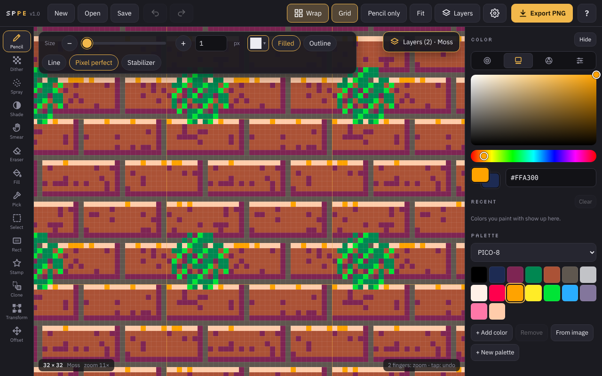

Everything you paint wraps around the edges, so the tile always fits together. You see it repeated around the canvas while you work, and the seams never show.

---

## Contents

- [Getting started](#getting-started)
- [Seamless painting with Wrap](#seamless-painting-with-wrap)
- [Tools](#tools)
- [Brush shapes](#brush-shapes)
- [Colors](#colors)
- [Layers](#layers)
- [Pattern layers: tiles inside tiles](#pattern-layers-tiles-inside-tiles)
- [Edge strips: tiles with a border](#edge-strips-tiles-with-a-border)
- [Clone tool](#clone-tool)
- [Saving and exporting](#saving-and-exporting)
- [Settings and layout](#settings-and-layout)
- [Help with search](#help-with-search)
- [Keyboard shortcuts](#keyboard-shortcuts)
- [Touch and stylus gestures](#touch-and-stylus-gestures)
- [Privacy](#privacy)

---

## Getting started

1. Open **https://fifdesign.github.io/sppe/** in Safari, Chrome or any modern browser.
2. **Install it like an app** (optional): in the browser's share or menu, choose **Add to Home Screen**. It then opens full screen and also works offline.
3. Tap **New** to choose a canvas size, or start painting on the example texture.
4. Your work is saved automatically in the browser. Use **Save** to keep a project file (`.sppe`) and **Export PNG** to get images.

Tip: tap **?** at the top right at any time. The help explains every button and has a search field.

## Seamless painting with Wrap

The **Wrap** button decides how the canvas repeats:

| Mode | Use it for |
|---|---|
| **Both directions** | classic square tiles for floors, walls and terrain |
| **Only horizontal (X)** | side-scroller strips, borders that run left to right |
| **Only vertical (Y)** | tall columns, walls with a real top or bottom |
| **Off** | normal images without repeating |

Every tool follows the wrap: lines, fills, shapes and selections continue across the edges. Press **W** to cycle the modes.

Canvases can be up to **4096 px per side** (and 4.2 million pixels in total), for example 1024 × 4096 for long strips. You can zoom out to ½, ¼ and ⅛ to see big canvases.

## Tools

Each tool shows its options in a bar above the canvas. **Tap the active tool again** to hide that bar and get more room; tap once more to bring it back.

| Key | Tool | What it does |
|---|---|---|
| B | **Pencil** | Draws pixels. Square, round or any of 284 brush shapes, filled or as outline. Pixel perfect lines and a stabilizer for smooth strokes. |
| N | **Line mode** | For Pencil, Eraser and Dither: draw straight lines, or tap point after point. Line styles Straight, Wave, Zigzag, Arcs, Scallops, Saw teeth and Blocks, with period, height and an optional shadow line. *Full width* runs the line across the whole canvas so it wraps seamlessly. |
| D | **Dither** | Paints dither patterns from 12% to 75%, optionally with the 2nd color in the gaps. |
| A | **Spray** | Airbrush dots inside any brush shape. **Flow** (speed), **Intensity** (how much of the shape can fill up in one stroke) and **Spacing** (minimum distance between dots). |
| S | **Shade** | Makes pixels darker or lighter, step by step, optionally snapping to the palette. Reverse takes shading back. |
| U | **Smear** | Pushes pixels along the stroke. |
| E | **Eraser** | Erases with the same shapes as the Pencil. |
| F | **Fill** | Flood fill that continues across the wrap edges. |
| I | **Pick** | Picks a color from the canvas. You can also hold the pen still while painting. |
| R | **Select** | Rectangle, square, ellipse, circle, lasso and magic wand. Tools then only paint inside the selection. |
| O | **Rect** | Rectangles and ellipses, filled or as outline. Drag for any size or tap to place an exact W × H. |
| K | **Stamp** | Stamps brush shapes or your own colored stamps, rotated and flipped, optionally snapped to a grid. |
| C | **Clone** | Copies pixels by painting, from a source point or by repeating a selected region (see below). |
| T | **Transform** | Move, scale, flip and rotate a layer or selection. |
| M | **Offset** | Slides the layer around the tile to check the seams. |

## Brush shapes

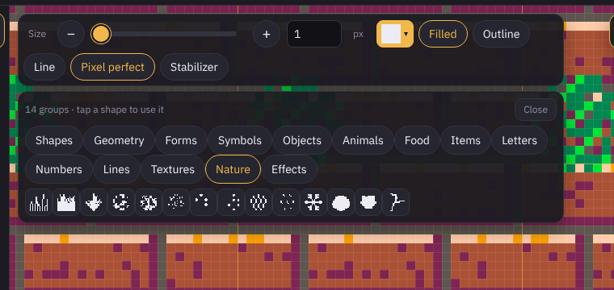

There are **284 brush shapes in 14 groups**: Shapes, Geometry, Forms, Symbols, Objects, Animals, Food, Items, Letters, Numbers, Lines, Textures, Nature and Effects. All of them can be used **filled or as an outline** with any line width.

The options bar stays small: it shows the current shape and the **last six you used**. Tap the current shape (▾) to open all groups, pick one, and the window closes again. Pencil, Eraser, Spray, Shade, Smear and Clone all share the shapes.

**Own stamps:** select an area, tap **Make stamp**, and it becomes a colored stamp under *Own shapes* in the Stamp tool.

## Colors

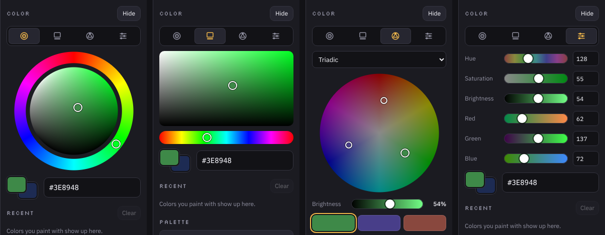

Switch between four pickers with the icons under **COLOR**:

- **Disc**: hue ring outside, saturation and brightness in the disc.
- **Classic**: square and hue bar.
- **Harmony**: a color wheel that shows matching colors (Complementary, Split complementary, Analogous, Triadic, Tetradic). Tap a swatch below the wheel to use that color.
- **Value**: exact sliders and numbers for hue, saturation, brightness, red, green and blue.

More color features:

- **Shades**: hold any color swatch for a moment to get **16 shades** of it, from very bright to dark.
- **Palettes**: classic pixel-art palettes, the SPPE 32 set and **101 theme palettes** (Beach, Winter, Forest, Desert, Ocean, Sunset & Sky, Autumn, Spring, Night & City, Fantasy, Retro & Games, Food & Candy).
- **Your own palettes** with names, saved inside your projects.
- **Palette from image**: build a palette of 2 to 64 colors from the canvas or any picture.
- **Recent** colors, one tap away.

## Layers

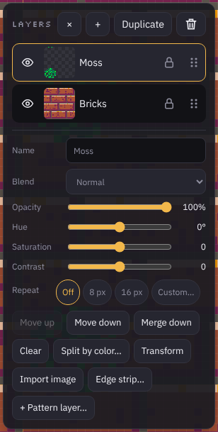

Up to **16 layers** with name, blend mode, opacity and alpha lock.

- **Drag and drop** a layer by its grip (⠿) to change the order.
- **Hue, saturation and contrast** per layer, without touching the pixels. *Apply to pixels* bakes the colors in.
- **Repeat**: the top-left area of a layer (8, 16, 32 … px or a custom size) repeats over the whole layer, so whatever you paint shows up in every copy. Ideal for teeth every 16 px or waves every 32 px. **Bake** stops the repeat and keeps the copies as normal pixels.
- **Clear**, **Duplicate**, **Merge down**, **Import image** and **Transform**.

**Split by color** moves colors of a layer onto layers of their own. That's handy when you painted two things on one layer by accident:

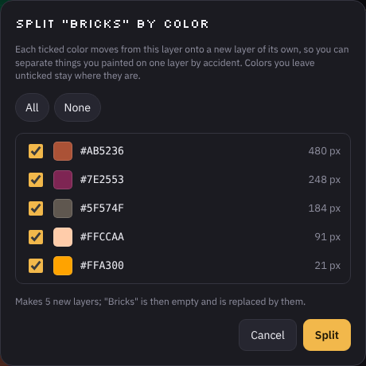

## Pattern layers: tiles inside tiles

Pattern layers build a bigger tile from small **modules**, live. Paint a module once, and every cell that uses it updates at the same moment.

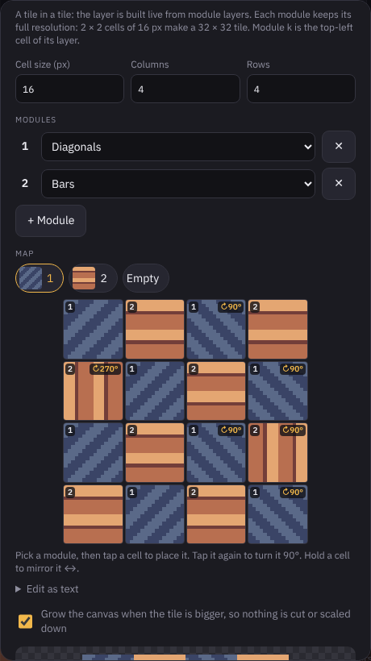

1. Paint each module on its own layer (module 1, 2, 3 …).
2. In Layers, tap **+ Pattern layer…** and set the cell size, columns and rows.
3. In the **map grid**, pick a module and tap a cell to place it. **Tap again** to turn it by 90°, **hold** to mirror it.
4. Every cell keeps the **full resolution** of its module. 2 × 2 cells of 16 px make a 32 × 32 tile, and the canvas grows to fit.

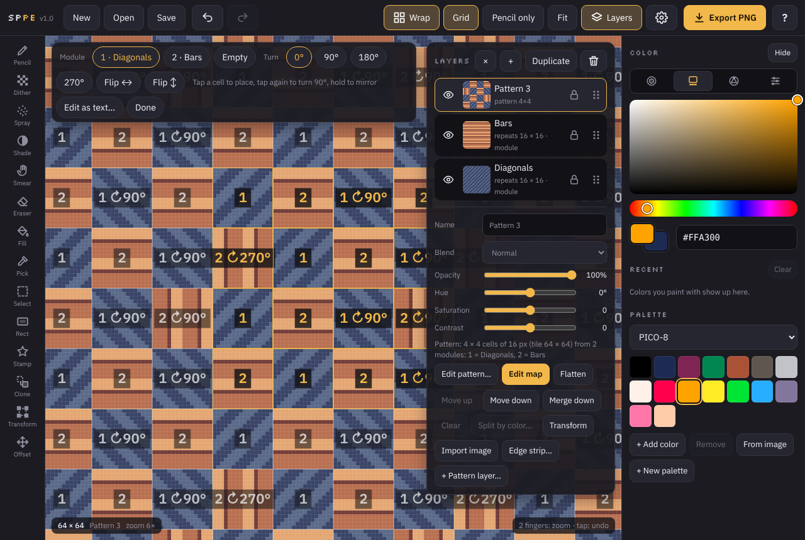

With **Edit map** you can change the layout directly on the canvas. A pattern layer can itself be a module of an even bigger pattern. When exporting, you choose whether the module layers are included.

## Edge strips: tiles with a border

Many game textures are a repeating body with a real edge on top, such as grass on bricks or a wavy shoreline.

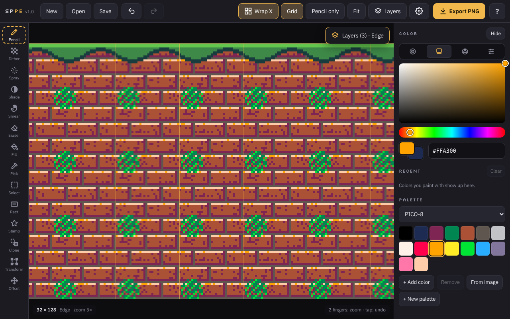

1. Paint your square tile.
2. Open **Settings → Edge strip…** (or the button in Layers) and choose the direction and the length (2× to 64×).
3. The tile layers keep repeating down the strip, wrap switches to the open axis, and a new **Edge** layer is ready for the border.
4. Paint the edge, for example with Line mode, *Full width* and the Wave or Saw teeth style.

## Clone tool

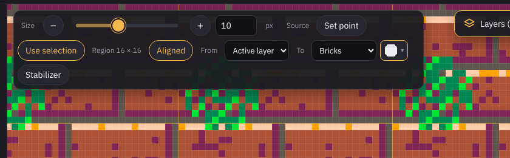

- **Point**: tap *Set point* (or Alt-click) on the spot to copy from, then paint somewhere else. A ring shows where the copy comes from.
- **Region**: select an area, tap *Use selection*, and painting anywhere **repeats that region like a tile**.
- **From / To**: copy from the active layer, everything visible or any single layer, and paint onto another layer or a new one, so the clones stay separate.

## Saving and exporting

- **Save** creates an `.sppe` project file with all layers and their settings, the palette, the wrap mode and your own stamps. **Open** loads it again, or imports an image.
- **Export PNG** saves the merged image and/or **every layer as its own PNG**, scaled 1× to 16×, optionally as a tiled preview sheet. Several files come as one ZIP. Exports are **lossless**, so every pixel stays exact.
- **Autosave** keeps your current work in this browser.

## Settings and layout

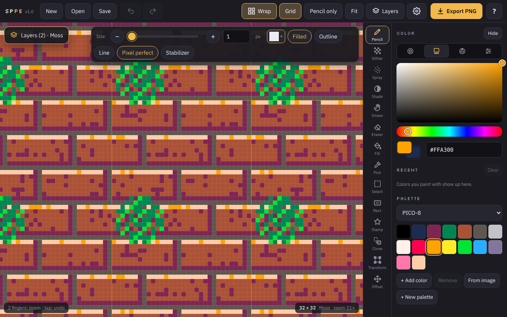

Under **⚙ Settings** you can:

- put the **tool rail** and the **color panel** each on the **left or right** (also both on one side),
- scale the whole **interface size** from 50% to 130%,
- set how long **holding still** picks a color,
- open **Edge strip…**.

## Help with search

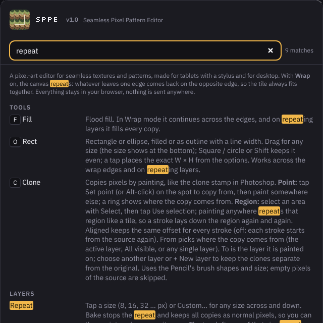

The **?** button explains every tool and option. Type in the search field to show only what matches, with your search marked.

## Keyboard shortcuts

| Keys | Action |
|---|---|
| ⌘/Ctrl + Z, ⌘/Ctrl + Shift + Z or Y | Undo, redo |
| ⌘/Ctrl + S | Save the project |
| ⌘/Ctrl + A / D | Select all / clear the selection |
| ⌘/Ctrl + Shift + I | Invert the selection |
| ⌘/Ctrl + J | Copy the selection to a new layer |
| Delete | Clear the selected pixels |
| B N D A S U E F I R O K C T M | Tools (see the table above) |
| [ and ] | Smaller / bigger brush |
| X | Swap main and 2nd color |
| W | Cycle the wrap mode |
| G / L | Grid / layers panel |
| 0 | Fit the canvas to the screen |
| Space + drag | Pan the view |
| Enter / Esc | Apply / cancel a transform, Esc also closes dialogs |
| ? | Help |

## Touch and stylus gestures

| Gesture | Action |
|---|---|
| Two-finger tap | Undo |
| Three-finger tap | Redo |
| Pinch, two-finger drag | Zoom and pan |
| Hold the pen still | Pick the color under it |
| Hold a color swatch | 16 shades of that color |
| Hold a map cell | Mirror it |
| **Pencil only** button | Only the stylus draws, fingers zoom and pan, so your palm never paints |

## Privacy

SPPE is one single web page. **Everything stays in your browser**: there is no account, no server, no tracking and no external requests. Your projects are only stored on your device and in the files you save.

---

### For developers

The whole app is the single file `index.html`. `sw.js` keeps it available offline, and `manifest.webmanifest` and the icons are for the home screen. The screenshots for this page are in `docs/images`.

---

Made by [www.fifdesign.com](https://www.fifdesign.com) with big help from [claude.ai](https://claude.ai)
© 2026
